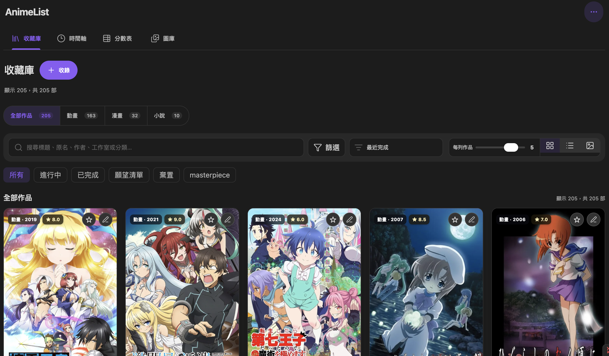
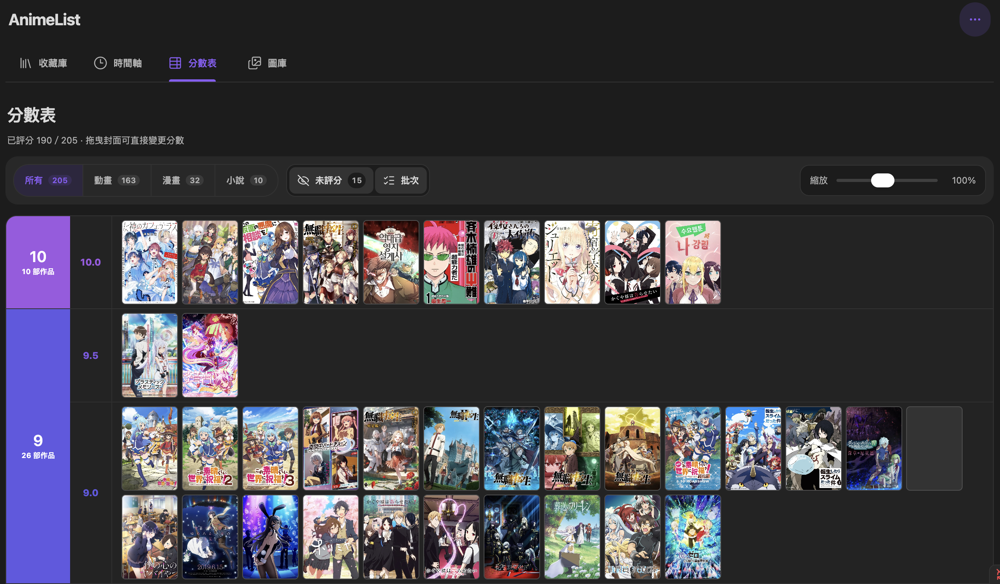
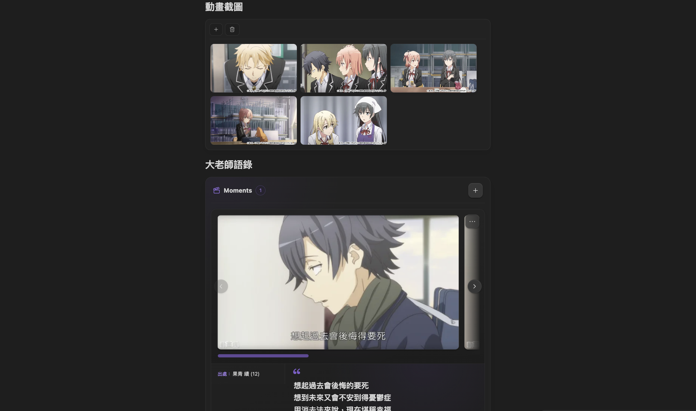
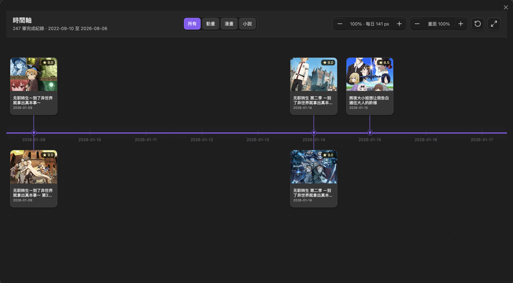
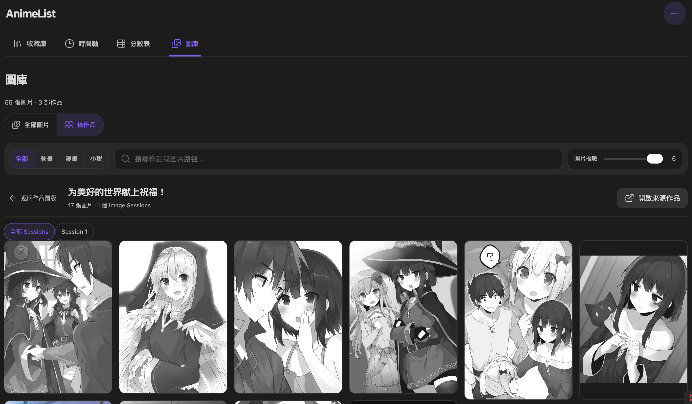
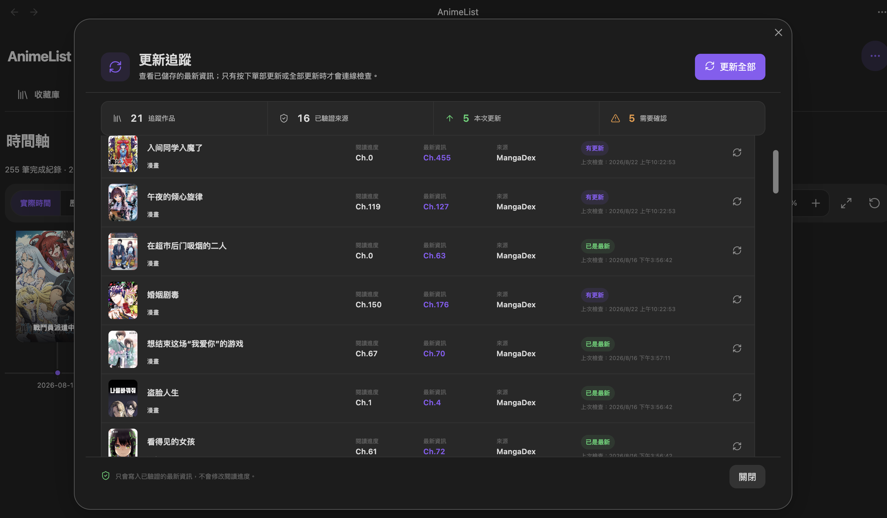

# AnimeList

AnimeList is a local-first Obsidian plugin for tracking anime, manga, and novels in ordinary Markdown files. It provides a shared workspace for the Library, Timeline, Score Dashboard, and Images, plus metadata search, local covers, progress tracking, ratings, templates, release tracking, reusable note media, and portable Library export.

Your Markdown notes remain the source of truth. Removing the plugin does not remove your records, notes, or images.

> [!CAUTION]
> **Existing libraries and update cleanup**
>
> Existing 1.4.0 and older libraries remain readable without an automatic startup migration. Older notes may still be missing classification metadata introduced in 1.3, and older generated note bodies may contain a redundant standalone cover below `animelist-detail`. Back up or sync the vault before using **Settings → Updates & cleanup**. The available cleanup tools are explicit, review-first operations and preserve unrelated frontmatter and Markdown body content.
>
> **For 1.6.0:** Back up or fully sync the vault before running any cleanup that removes files or applies title/metadata changes. Review proposed changes before confirming; choose **Only new or unfinished items** for normal scans and **Rescan all items** only when needed. If an Image Section or Moment was edited elsewhere while its editor was open, close and reopen the note before retrying rather than overwriting the newer content. The independent Ranking data file (`.obsidian/animelist-ranking.json`) should be included in vault backups and sync. Ranking conflicts may require reopening Obsidian; do not manually delete that file or its recovery backups.

<table>
  <tr>
    <td width="50%" align="center">
      <br>
      <sub><b>Library</b></sub>
    </td>
    <td width="50%" align="center">
      <br>
      <sub><b>Score Dashboard</b></sub>
    </td>
  </tr>
  <tr>
    <td width="50%" align="center">
      <br>
      <sub><b>Note media</b></sub>
    </td>
    <td width="50%" align="center">
      <br>
      <sub><b>Timeline</b></sub>
    </td>
  </tr>
  <tr>
    <td width="50%" align="center">
      <br>
      <sub><b>Image Library</b></sub>
    </td>
    <td width="50%" align="center">
      <br>
      <sub><b>Tracking</b></sub>
    </td>
  </tr>
</table>

> [!NOTE]
> **What's new**
>
> **AnimeList 1.6.0**
>
> - **Rank completed works by preference:** Compare two covers at a time to build a personal, independent ranking for anime, manga, and novels. Pause and resume later, revisit unranked works, and keep rankings separate from numeric scores.
> - **Make your library look the way you want:** Replace an existing work's cover with your own local image without losing its metadata or previous artwork.
> - **Find works across more languages:** Improved search for alternate Chinese, Japanese, Korean, and English titles, with clearer source identity and title provenance. Review suggested names for existing works instead of automatically rewriting them.
> - **Maintain older libraries with more control:** Incremental or full rescan choices, review-first updates, and stronger protection for existing notes, images, and ranking data.
> - **Smoother day-to-day use:** More consistent Add/Edit dialogs, faster first-result presentation, and refined touch navigation on phones while preserving desktop behavior.

## Features

- One Markdown-based library for anime, manga, and novels.
- Metadata search through Bangumi, AniList, and Open Library, with structured classification metadata for supported works.
- Card, list, and poster views with search, sorting, combined company/quarter/tag filters, and persisted Card/Thumbnail row-density controls.
- Media-specific progress tracking and dated serial entries with optional per-entry covers.
- Optional manga/novel latest-release tracking that is separate from personal reading progress.
- Reusable Image Sections and Moments stored directly in ordinary Markdown notes, including masonry image ordering and optional whole-image stacked Moments.
- A shared AnimeList workspace for Library, Timeline, Score Dashboard, and Images.
- An Images browser derived from existing Image Sections without copying source assets.
- A Score Dashboard for direct and batch rating changes.
- Pairwise preference **Ranking** for completed works, stored independently of scores and media-note Markdown.
- Favorite mode or reusable Masterpiece categories.
- A pannable, independently scalable completion timeline with History mode and a density overview.
- Versioned JSON and readable Text Library export with safe templates.
- Local series, serial-entry, Image Section, and Moment images with safe reference-aware cleanup.
- Replace an existing series cover with a local image from its Edit dialog; original media files are preserved.
- Traditional Chinese, Simplified Chinese, English, Japanese, and Korean interface support.
- Desktop and mobile support without a Dataview dependency.

## Installation

### Community plugins

1. Open **Settings → Community plugins** in Obsidian.
2. Select **Browse** and search for **AnimeList**.
3. Install and enable the plugin.

### Manual installation

1. Download `main.js`, `manifest.json`, and `styles.css` from the matching GitHub release.
2. Copy them into `<vault>/.obsidian/plugins/animelist/`.
3. Reload Obsidian and enable **AnimeList** under **Community plugins**.

## Quick start

1. Open AnimeList from the ribbon or run **AnimeList: Open library** from the command palette.
2. Select **收錄**, choose anime, manga, or novel, and search for a title.
3. Review the imported metadata and save the note.
4. Update its status, progress, dates, rating, or special label from the library. For completed works, open **Scores → Ranking** to compare titles and build a preference order.
5. For manga or novels, enable **Latest release tracking** under Settings → Features if you want source-backed latest chapter/volume information.
6. Inside a media note, use the editor context menu **AnimeList** submenu to insert an Image Section or Moments section where you want it.

AnimeList can display its main interface in Traditional Chinese, Simplified Chinese, English, Japanese, or Korean. The Settings page itself stays in English. Choose a language there or follow Obsidian's interface language. Recognized provider-supplied tag/category labels are displayed in the selected interface language, while media titles, raw provider metadata, custom reusable tags, Markdown/frontmatter, and existing templates are not rewritten.

## Documentation

See the [User Guide](docs/USER_GUIDE.md) for workspace navigation, Library layouts, status rules, progress units, serial-entry covers, metadata and filters, reusable tags, release tracking, Images, Image Sections, Moments, Library Export, cleanup tools, Masterpiece categories, the Score Dashboard, Timeline, Markdown data, and templates.

## Metadata, network access, and privacy

- Search and enrichment queries are sent only to enabled metadata providers.
- Release tracking, when enabled, contacts its configured public metadata/catalog sources and supported official public chapter pages; it does not send personal ratings, progress, dates, or note-body text.
- Personal ratings, progress, dates, labels, Moments text, and note content stay in the vault.
- Covers and note-media images are stored locally when available, with remote-image fallback only where the relevant feature supports it.
- AnimeList does not include telemetry or a private remote library database.

## Development

Requirements: Node.js 18 or newer and npm.

```bash
npm ci
npm run check
```

For a production bundle:

```bash
npm run build
```

See [CONTRIBUTING.md](CONTRIBUTING.md), the [manual test checklist](docs/MANUAL_TEST_CHECKLIST.md), [CHANGELOG.md](CHANGELOG.md), and [ROADMAP.md](ROADMAP.md) for project details.

## License

[MIT](LICENSE)
